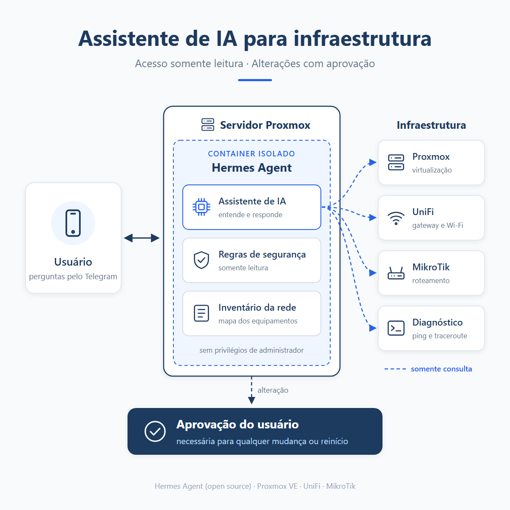

# Assistente de IA para infraestrutura

Um assistente de IA que responde, pelo Telegram, perguntas sobre a sua rede e o seu servidor Proxmox. Ele **apenas consulta** os equipamentos: qualquer alteração precisa da sua aprovação.



Ele é baseado no [Hermes Agent](https://github.com/NousResearch/hermes-agent) (open source, da Nous Research) e roda em um container LXC no Proxmox VE.

**Exemplos de perguntas:**
- "Como está a rede agora?"
- "Algum container está com pouca memória ou pouco disco?"
- "Quais dispositivos estão conectados ao Wi-Fi?"

---

## Sumário

1. [Como funciona](#como-funciona)
2. [Requisitos](#requisitos)
3. [Passo 1: baixar o projeto](#passo-1-baixar-o-projeto)
4. [Passo 2: criar o container](#passo-2-criar-o-container)
5. [Passo 3: criar o acesso somente leitura no Proxmox](#passo-3-criar-o-acesso-somente-leitura-no-proxmox)
6. [Passo 4: preparar o container](#passo-4-preparar-o-container)
7. [Passo 5: instalar o Hermes Agent](#passo-5-instalar-o-hermes-agent)
8. [Passo 6: conectar o Telegram](#passo-6-conectar-o-telegram)
9. [Passo 7: configurar as integrações](#passo-7-configurar-as-integrações)
10. [Passo 8: ativar os serviços](#passo-8-ativar-os-serviços)
11. [Passo 9: proteger com firewall](#passo-9-proteger-com-firewall)
12. [Testar](#testar)
13. [Segurança](docs/seguranca.md)
14. [Solução de problemas](docs/solucao-de-problemas.md)

---

## Como funciona

| Parte | O que faz |
|---|---|
| **Telegram** | Canal de conversa. Só os usuários liberados conseguem falar com o assistente. |
| **Hermes Agent** | Entende a pergunta, escolhe as ferramentas e responde em português. |
| **SOUL.md** | Define o comportamento do assistente: idioma, tom e regras de segurança. |
| **ativos.md** | Inventário da rede, lido pelo assistente antes de cada diagnóstico. |
| **`pveapi`** | Consulta a API do Proxmox com um token **somente leitura** (papel `PVEAuditor`). |
| **`unifi`** | Consulta a controladora UniFi com um usuário **somente leitura**. |
| **SSH** | Acesso ao MikroTik com um usuário do grupo `read`. |

A segurança tem duas camadas:
1. **Técnica (a que importa):** as contas usadas pelo assistente não têm permissão para alterar nada.
2. **Instruções (complemento):** o SOUL.md pede ao assistente que nunca altere nada sem confirmação.

> Instruções em texto não são uma barreira de segurança. Se a conta tiver permissão de escrita, a IA consegue escrever. Leia [docs/seguranca.md](docs/seguranca.md).

---

## Requisitos

- Proxmox VE 8 ou 9, com acesso root ao host
- Template LXC do Ubuntu 24.04 ou mais recente
- Recursos para o container: **2 a 4 vCPUs, 3 GB de RAM, 16 GB de disco**
- Uma conta no Telegram
- Uma conta em um provedor de modelo de IA (por exemplo, Nous Portal, OpenRouter, OpenAI) ou um servidor local (Ollama, LM Studio)
- Opcional: controladora UniFi e/ou roteador MikroTik

---

## Passo 1: baixar o projeto

No **host Proxmox** (como root):

```bash
apt install -y git
git clone https://github.com/fbvenceslau/assistente-ia-infraestrutura.git
cd assistente-ia-infraestrutura
```

---

## Passo 2: criar o container

Abra `scripts/01-criar-container.sh` e ajuste as variáveis do início (ID, IP, gateway, storage e bridge). Depois execute:

```bash
bash scripts/01-criar-container.sh
```

O script baixa o template do Ubuntu, cria um container **sem privilégios**, configura para iniciar com o servidor e liga o container.

---

## Passo 3: criar o acesso somente leitura no Proxmox

Ainda no **host Proxmox**:

```bash
bash scripts/02-proxmox-somente-leitura.sh
```

O script cria o usuário `hermes@pve` com o papel `PVEAuditor` (apenas leitura) e gera um token de API.

**Copie o valor exibido no final.** Ele aparece uma única vez e será usado no Passo 7.

---

## Passo 4: preparar o container

Copie o projeto para dentro do container e execute o script de preparação (troque `140` pelo ID do seu container):

```bash
CTID=140
tar czf /tmp/projeto.tgz -C .. assistente-ia-infraestrutura
pct push $CTID /tmp/projeto.tgz /root/projeto.tgz
pct exec $CTID -- bash -c "cd /root && tar xzf projeto.tgz && bash assistente-ia-infraestrutura/scripts/03-preparar-container.sh"
```

O script:
- instala as ferramentas de diagnóstico (ping, traceroute, mtr, dig, nmap, jq)
- configura o idioma português
- cria o usuário `hermes`, **sem acesso de administrador (sudo)**
- instala os comandos `pveapi` e `unifi` e os serviços do systemd
- copia os modelos de configuração para `/home/hermes/.hermes/`

---

## Passo 5: instalar o Hermes Agent

Entre no container e troque para o usuário `hermes`:

```bash
pct enter 140
su - hermes
```

Instale o Hermes Agent pelo instalador oficial:

```bash
curl -fsSL https://hermes-agent.nousresearch.com/install.sh | bash
source ~/.bashrc
hermes --version
```

A instalação leva de 10 a 20 minutos e usa cerca de 4 GB de disco. Se ela falhar com `Connection reset by peer`, foi uma queda na conexão com o GitHub. Basta rodar o comando de novo.

> No final, o instalador sugere `hermes gateway install`. **Não use esse comando:** este projeto já traz o próprio serviço do systemd (Passo 8), e os dois entrariam em conflito.

Execute o assistente de configuração e escolha o provedor e o modelo de IA:

```bash
hermes setup
```

> Se você usa o Nous Portal, pode usar `hermes setup --portal`. Consulte a [documentação do Hermes Agent](https://github.com/NousResearch/hermes-agent) para os outros provedores.

---

## Passo 6: conectar o Telegram

1. No Telegram, abra o **@BotFather**, envie `/newbot` e siga as instruções. Guarde o **token** do bot.
2. Descubra o seu **ID numérico** do Telegram, por exemplo, falando com o **@userinfobot**.
3. Ainda como usuário `hermes`, execute:

```bash
hermes gateway setup
```

Escolha **Telegram** e informe o token do bot. Depois confira o arquivo `~/.hermes/.env`, que deve ter:

```bash
TELEGRAM_BOT_TOKEN=<token do BotFather>
TELEGRAM_ALLOWED_USERS=<seu ID numérico>
```

> **Importante:** `TELEGRAM_ALLOWED_USERS` define quem pode falar com o assistente. Nunca deixe esse campo vazio.

Veja o modelo completo em [config/env.example](config/env.example).

---

## Passo 7: configurar as integrações

Todos os arquivos abaixo ficam em `/home/hermes/.hermes/` e já foram copiados como modelo no Passo 4.

**a) Endereços** — edite `secrets/endpoints.env`:

```bash
PVE_URL=https://<IP-DO-PROXMOX>:8006
UNIFI_URL=https://<IP-DA-CONTROLADORA>:<PORTA>
```

**b) Token do Proxmox** — cole em `secrets/pve.token` o valor gerado no Passo 3, neste formato:

```
PVEAPIToken=hermes@pve!agent=<valor-do-token>
```

**c) UniFi (opcional)** — na controladora UniFi, crie um administrador local com a função **View Only** (somente visualização). Depois preencha `secrets/unifi.json`:

```json
{"username": "hermes", "password": "<senha>"}
```

**d) MikroTik (opcional)** — gere uma chave SSH exclusiva para o assistente:

```bash
ssh-keygen -t ed25519 -f ~/.ssh/hermes_ativos -N "" -C "hermes-agent"
cat ~/.ssh/hermes_ativos.pub
```

No MikroTik, crie um usuário do grupo **read** e importe a chave (envie o arquivo `.pub` para o roteador antes):

```
/user add name=hermes group=read address=<IP-DO-CONTAINER>/32
/user ssh-keys import public-key-file=hermes_ativos.pub user=hermes
```

Depois copie `config/ssh_config.example` para `~/.ssh/config` e ajuste os IPs.

**e) Comportamento e inventário** — revise os dois arquivos:
- `SOUL.md`: personalidade e regras do assistente
- `ativos.md`: lista dos seus equipamentos (IPs, funções, como acessar)

Proteja os arquivos de segredo:

```bash
chmod 700 ~/.hermes/secrets && chmod 600 ~/.hermes/secrets/* ~/.hermes/.env
```

---

## Passo 8: ativar os serviços

Volte para root (`exit`) e ative os serviços:

```bash
systemctl daemon-reload
systemctl enable --now hermes-gateway
systemctl status hermes-gateway --no-pager
```

Nos logs, os avisos `No messaging platforms enabled` ou `not logged into Nous Portal` indicam que faltou concluir o Passo 5 (`hermes setup`) ou o Passo 6 (`hermes gateway setup`).

**Painel web (opcional):** o Hermes tem um painel de administração na porta `9119`. Como o serviço escuta na rede (`--host 0.0.0.0`), o Hermes exige login. Antes de ativar, configure o login do painel no `.env` (veja [config/env.example](config/env.example)) e o firewall do Passo 9. Depois:

```bash
systemctl enable --now hermes-dashboard
```

---

## Passo 9: proteger com firewall

No **host Proxmox**, copie o modelo de firewall e troque o IP de exemplo pelo IP do computador de onde você administra:

```bash
cp firewall/CTID.fw.example /etc/pve/firewall/140.fw
nano /etc/pve/firewall/140.fw
```

O script do Passo 2 já cria a interface de rede com o firewall ligado (`firewall=1`). Com essas regras, só o seu computador acessa o SSH e o painel do container.

> O firewall também precisa estar ativo no nível do datacenter (**Datacenter → Firewall → Options → Firewall: Yes**). Antes de ativar, confirme que existe uma regra liberando o seu acesso à porta 8006 do Proxmox.

---

## Testar

No container, como usuário `hermes`:

```bash
pveapi /version          # deve mostrar a versão do Proxmox
pveapi /cluster/resources
unifi /api/s/default/stat/health
ssh mkt '/system resource print'
```

Teste também se o acesso é **realmente** somente leitura. O comando abaixo tenta criar o usuário `root@pam`, que já existe, então nada é criado em nenhum caso:

```bash
. ~/.hermes/secrets/endpoints.env
curl -sk -w ' [%{http_code}]\n' -X POST -d userid=root@pam \
  -H "Authorization: $(cat ~/.hermes/secrets/pve.token)" \
  "$PVE_URL/api2/json/access/users"
```

- **`Permission check failed ... [403]`**: correto, o token é somente leitura.
- **`user 'root@pam' already exists ... [500]`**: o token tem permissão de escrita. Revise o Passo 3.

Por fim, mande uma mensagem para o seu bot no Telegram: **"Como está a rede agora?"**

---

## Estrutura do projeto

```
assistente-ia-infraestrutura/
├── README.md                    este guia
├── LICENSE                      licença MIT
├── images/arquitetura.png       diagrama
├── scripts/
│   ├── 01-criar-container.sh    (host) cria o LXC
│   ├── 02-proxmox-somente-leitura.sh  (host) usuário e token PVEAuditor
│   └── 03-preparar-container.sh (container) pacotes, usuário, serviços
├── bin/
│   ├── pveapi                   consulta a API do Proxmox
│   └── unifi                    consulta a API da UniFi
├── systemd/
│   ├── hermes-gateway.service
│   └── hermes-dashboard.service
├── config/
│   ├── SOUL.md.example          comportamento do assistente
│   ├── ativos.md.example        inventário da rede
│   ├── env.example              variáveis do Telegram e do painel
│   ├── endpoints.env.example    endereços do Proxmox e da UniFi
│   └── ssh_config.example       atalhos SSH
├── firewall/CTID.fw.example     regras de firewall do container
└── docs/
    ├── seguranca.md
    └── solucao-de-problemas.md
```

---

## Licença

[MIT](LICENSE). O Hermes Agent é um projeto separado, com a sua própria licença.
